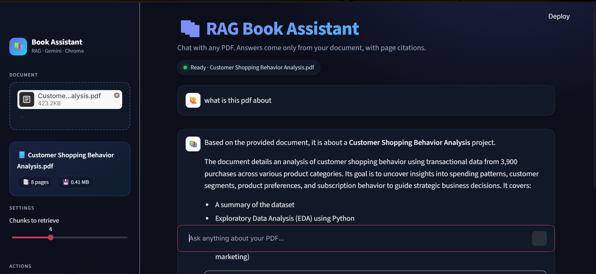
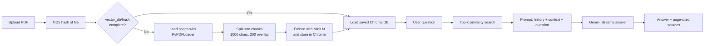

# 📚 RAG Book Assistant

Chat with any PDF. Upload a book, paper or set of notes and ask questions in natural language. Answers are generated **only from your document**, and every answer shows the **page numbers and exact text chunks** it used.

Built with **Streamlit, LangChain, ChromaDB, Hugging Face embeddings and Google Gemini**.



---

## ✨ Features

- **Drag-and-drop PDF upload** with a document card showing file name, page count and size
- **Retrieval-Augmented Generation (RAG):** answers are grounded in the uploaded document
- **Source citations:** every answer has an expandable *Sources* panel with chunk number, page number, similarity distance and the retrieved text
- **Streaming responses** (typing effect) powered by Gemini
- **Conversation memory:** the last few messages are passed to the model so follow-up questions work
- **Persistent vector database per PDF:** each book is indexed once and reused on later uploads
- **Indexing progress bar** while the vector database is built
- **Adjustable retrieval:** choose how many chunks (2 to 8) are retrieved per question
- **Sidebar controls:** *New book* and *Clear chat* buttons
- **Custom dark UI** with a status pill, empty-state guide and styled chat and source cards
- **Error handling** for a missing API key, PDFs with no extractable text and failed model calls

---

## 🧠 How it works



### 1. Indexing (once per PDF)
1. The uploaded file is hashed (MD5) from its **contents**. The same file always gets the same hash, whatever it is named.
2. The PDF is saved as `uploads/<hash>.pdf`.
3. If `vector_db/<hash>/.complete` exists, the saved database is loaded straight away and nothing is re-embedded.
4. Otherwise the PDF is read page by page with `PyPDFLoader` and split with `RecursiveCharacterTextSplitter` (**chunk size 1000, overlap 200**). Empty chunks are dropped.
5. Chunks are embedded with `sentence-transformers/all-MiniLM-L6-v2` and added to a Chroma collection in **batches of 64**, which drives the progress bar.
6. A `.complete` marker file is written when indexing finishes, so an interrupted build is detected and rebuilt rather than reused half-finished.

### 2. Question answering (every message)
1. The question is embedded and the **top-k most similar chunks** are retrieved from Chroma (`similarity_search_with_score`, default k = 4).
2. The chunks are joined into the context, and the **last 6 messages** become the conversation history.
3. A prompt with strict instructions (*answer only from the context; otherwise say the answer was not found*) is sent to **Gemini** (`gemini-3.5-flash`, temperature 0.2).
4. The answer is streamed to the UI with `st.write_stream`.
5. The retrieved chunks are shown as source cards with their **page number** and **distance score** (lower means more similar).

### 3. Why one database per PDF?
An earlier version deleted and rebuilt a single `chroma_db` folder on every upload. On Windows this failed with `PermissionError: [WinError 32]` because Chroma still had the files open. Giving each PDF its own folder named by file hash means **nothing is ever deleted while in use**, re-uploads are instant, and many books can be stored side by side.

### 4. Streamlit rerun handling
Streamlit re-runs the script on every interaction, so:
- The embedding model and LLM are created once with `st.cache_resource`.
- The vector store, PDF info and chat history live in `st.session_state`.
- A PDF is only processed when its hash differs from the one already loaded.

---

## 🛠️ Tech stack

| Layer | Technology |
|---|---|
| UI | Streamlit, custom CSS |
| PDF loading | PyPDF / LangChain `PyPDFLoader` |
| Chunking | LangChain `RecursiveCharacterTextSplitter` |
| Embeddings | `sentence-transformers/all-MiniLM-L6-v2` (Hugging Face, runs locally) |
| Vector database | ChromaDB (persistent, one folder per PDF) |
| LLM | Google Gemini via `langchain-google-genai` |
| Orchestration | LangChain |

---

## 📁 Project structure

```
rag-book-assistant/
├── app.py                # Streamlit app (UI + RAG pipeline)
├── requirements.txt
├── README.md
├── .gitignore
├── .env                  # your Google API key (not committed)
├── .streamlit/
│   └── config.toml       # dark theme
├── assets/
│   └── screenshot.png
├── uploads/              # saved PDFs, named <hash>.pdf   (auto-created, git-ignored)
└── vector_db/            # one Chroma DB per PDF hash     (auto-created, git-ignored)
```

---

## 🚀 Getting started

### Prerequisites
- Python 3.10 or newer
- A free Google AI Studio API key: https://aistudio.google.com/apikey

### Installation

```bash
# 1. Clone the repository
git clone https://github.com/kolleparavarshith/RAG-Book-Assistant.git
cd RAG-Book-Assistant

# 2. Create and activate a virtual environment
python -m venv .venv
.venv\Scripts\activate          # Windows
# source .venv/bin/activate     # macOS / Linux

# 3. Install dependencies
pip install -r requirements.txt
```

### Configure your API key

Create a file named `.env` in the project root:

```
GOOGLE_API_KEY=your_api_key_here
```

> ⚠️ Never commit `.env`. It is listed in `.gitignore`.

### Run

```bash
streamlit run app.py
```

Then open http://localhost:8501, upload a PDF from the sidebar and start asking questions. The first run downloads the embedding model (about 90 MB), and the first upload of a large book takes a few minutes to index.

---

## 💾 Storage notes

- Each uploaded PDF adds a copy in `uploads/` plus a database in `vector_db/<hash>/`.
- Re-uploading the same file (even renamed) reuses its existing database and does **not** create a new one.
- To free space, stop the app and delete a book's folder in `vector_db/` and its PDF in `uploads/`. It will simply be re-indexed if you upload it again.
- Chat history is kept per browser session and is not saved to disk.

---

## ⚠️ Limitations

- **Scanned PDFs** (images of pages) have no extractable text and need OCR, which is not included.
- Only **text** is indexed. Tables, charts and images are not interpreted.
- Answers are limited to the retrieved chunks, so very broad questions about a whole book may be incomplete.
- The distance score is shown for transparency. No formal accuracy evaluation has been run yet.
- Locally stored databases are not shared between machines. On hosted platforms with temporary storage, books are re-indexed after a restart.

---

## 🔭 Future improvements

- A "Your library" dropdown to switch between saved books without re-uploading
- A *Delete book* button that safely removes a book's PDF and database
- Saved chat history per book
- OCR support for scanned PDFs
- Hybrid search (keyword + vector) and re-ranking
- Retrieval quality evaluation
- Hosted vector database for cloud deployment

---

## 👤 Author

**Kollepara Naga Sri Lakshmi Varshith**
GitHub: [@kolleparavarshith](https://github.com/kolleparavarshith)

If you found this useful, consider giving the repo a ⭐